# EasyPlots

**A keyboard-driven plotting launcher for macOS.** Press a hotkey, type a line such as
`line run.csv x=time y=temp` (or pick the file and its columns from a list), press
Return, and a publication-quality PNG, PDF or SVG is saved. No Python, no notebook, no
spreadsheet charts, no waiting.

<p align="center">
  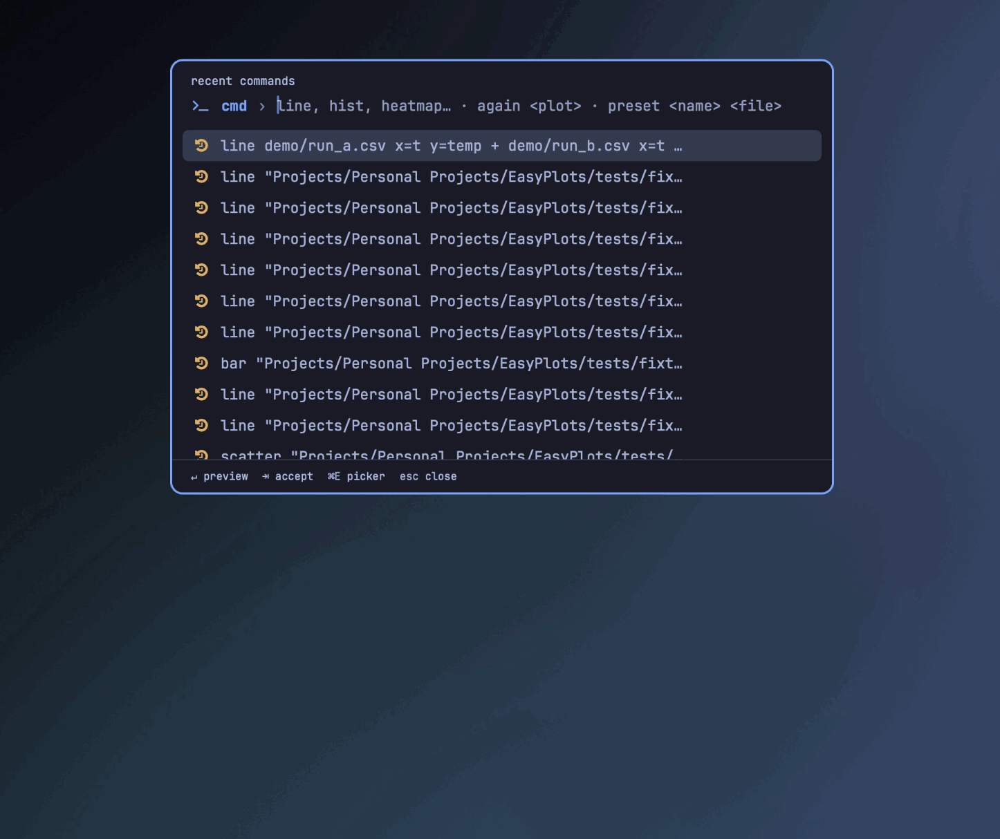
</p>

## Why

Most quick plots are the same three steps: open a file, choose two columns, and export a
figure that looks right in a report or a paper. Doing that in a notebook or a spreadsheet
takes minutes and a lot of clicking, and the result rarely matches the last figure you
made. EasyPlots turns it into a few seconds at the keyboard, with a look that is ready to
publish from the first try, and every plot is a line of text you can repeat, tweak or
run again on the next file.

## What it does

- **A menu-bar app with its own hotkey** (Ctrl+Option+P by default). A small search bar,
  in the spirit of the [fuzzel](https://codeberg.org/dnkl/fuzzel) launcher, opens on the
  screen you're using and closes again when you're done.
- **Two ways in, one result.** Pick step by step (file → plot type → columns), or type one
  command with suggestions for files, columns and options as you type. The pickers write
  the same command into the box, so every plot can be repeated, edited, saved as a
  preset, or run from the terminal.
- **A live preview** beside the list while you type, and a full preview before anything is
  saved, with a plot advisor underneath: "the legend covers data: legend=out puts it
  beside the plot". Press ⇥ and the fix is applied.
- **Publication-ready from the first try:** sizes in real units or a journal's
  (`--size=acs`), bundled fonts (STIX Two, Latin Modern, Source Sans 3), maths in labels
  (`ylabel="$E'$ (MPa)"`), proper ticks and minor ticks, and a colour-blind-safe palette.
  PNG, PDF and SVG look identical, because all three come from one drawing.
- **16 plot types** (see the gallery below), several **panels** in one figure (`;`),
  overlays of files and columns (`+`), shared axes, lettered panels and one legend for the
  whole figure.
- **Analysis built in:** fitted curves (linear, polynomials, exponential, logarithmic,
  power, or your own formula) with the equation and R² in the legend, error bars and
  bands, the mean of several runs (`stat=mean`), peaks, onsets, crossings, areas, slopes,
  baselines, calculated columns (`y=power/area`) and row filters (`where="temp > 20"`).
- **Your files as they are:** CSV, TSV and text files (the separator, decimal comma,
  header row, dates and junk lines above the header are detected), Excel and LibreOffice
  workbooks, JSON, a table copied to the clipboard, a pattern (`run_*.csv`) or a whole
  folder of files.
- **A terminal command,** `easyplots`, with the same language and the same engine, for
  scripts and for plotting from Terminal.
- **Local only:** nothing is sent anywhere, and a plot is never overwritten (a `-2` is
  added to the name instead). Each saved file remembers the command that made it, so
  `again plot.png` brings it back to edit.

Every feature, with an example each, is in [`docs/FEATURES.md`](docs/FEATURES.md), which is
also the searchable Help tab in Settings.

## Step by step, without typing

<p align="center">
  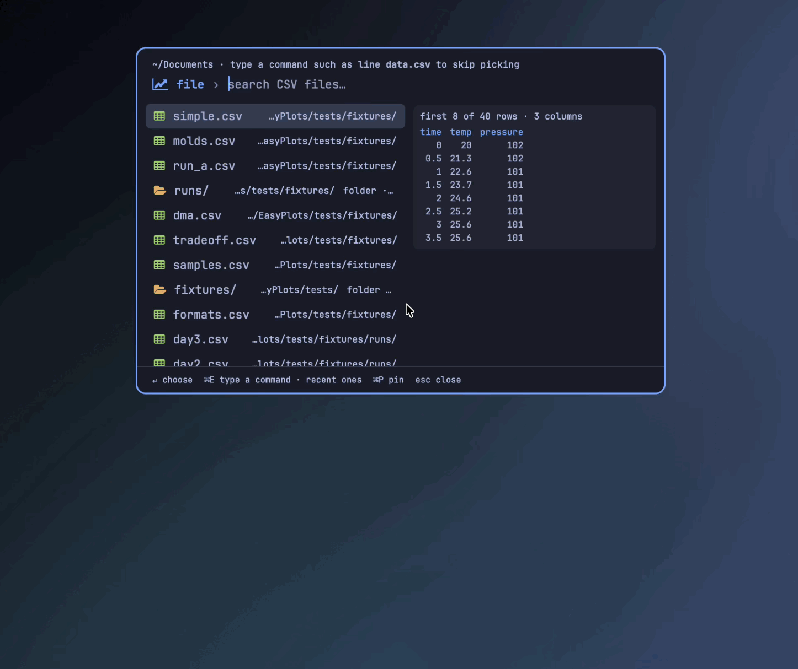
</p>

The picker shows each file's first rows before you choose it, offers only the columns a
plot type needs (a histogram asks for one, a heatmap for three), and draws a small
preview of the highlighted choice as you move through the list.

## Gallery

Each picture below is drawn by EasyPlots from the made-up files in
[`tests/fixtures/`](tests/fixtures/), with the command written under it. More in
[`docs/gallery/`](docs/gallery/).

<table>
  <tr>
    <td align="center" width="33%">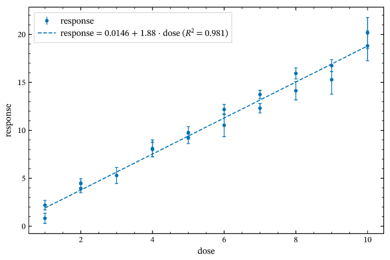<br><code>scatter … err=sd fit=linear</code></td>
    <td align="center" width="33%">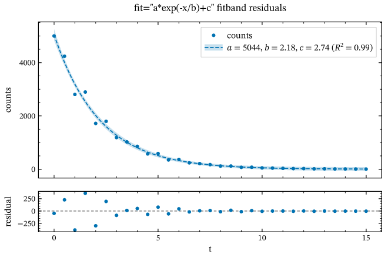<br><code>scatter … fit=&quot;a*exp(-x/b)+c&quot; fitband residuals</code></td>
    <td align="center" width="33%">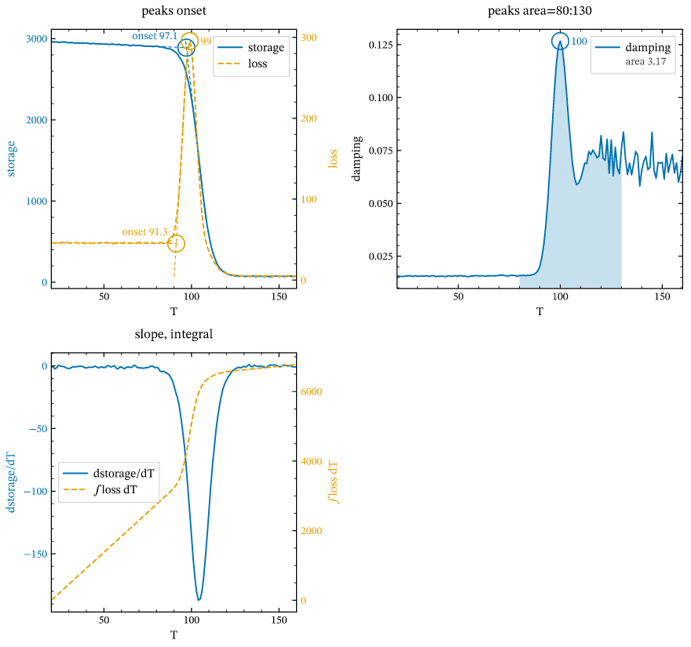<br><code>line … peaks onset ; … area=80:130 ; … slope + … integral</code></td>
  </tr>
  <tr>
    <td align="center" width="33%">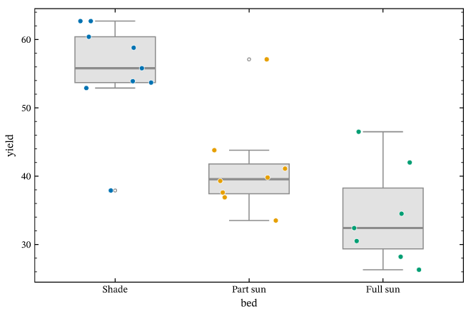<br><code>box … + strip …</code></td>
    <td align="center" width="33%">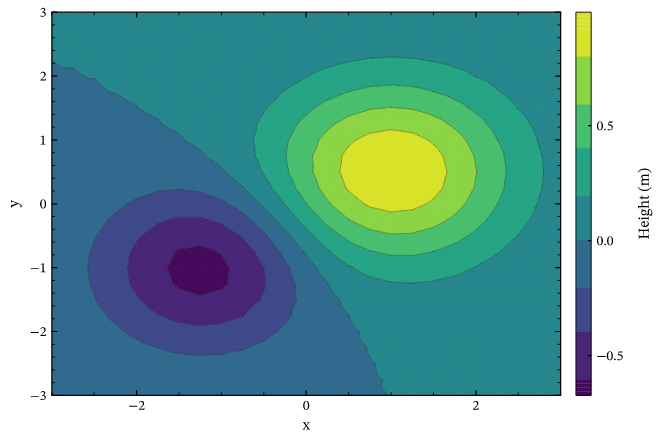<br><code>contour … filled zlabel=&quot;Height (m)&quot;</code></td>
    <td align="center" width="33%">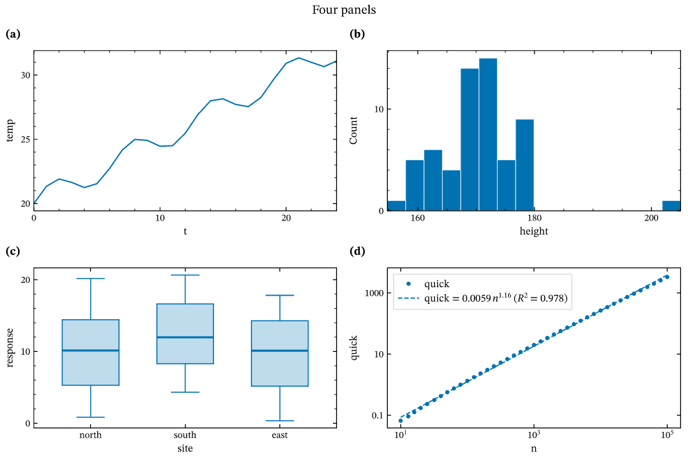<br><code>line … ; hist … ; box … ; scatter … --letters</code></td>
  </tr>
  <tr>
    <td align="center" width="33%">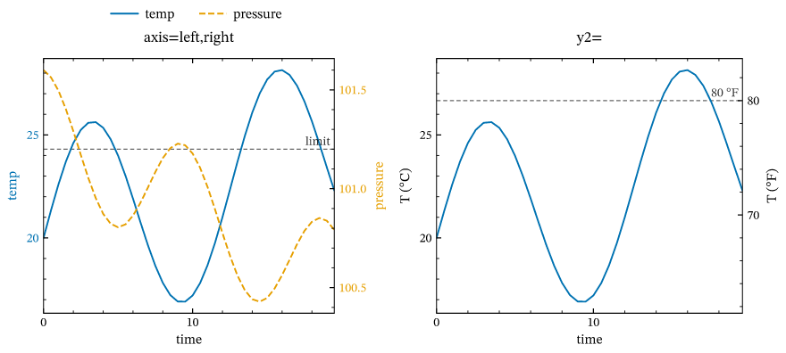<br><code>line … axis=left,right</code> · <code>y2=&quot;y*1.8+32&quot;</code></td>
    <td align="center" width="33%">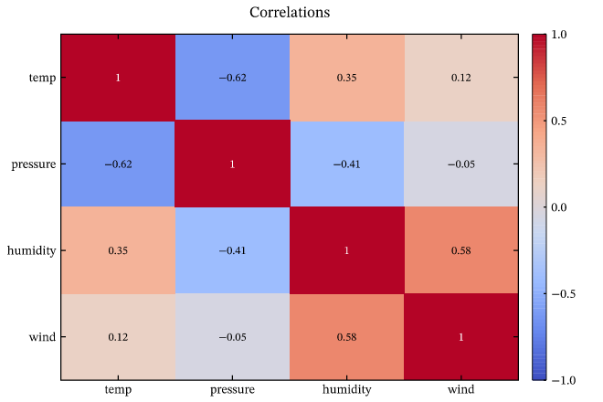<br><code>heatmap … values cmap=coolwarm</code></td>
    <td align="center" width="33%">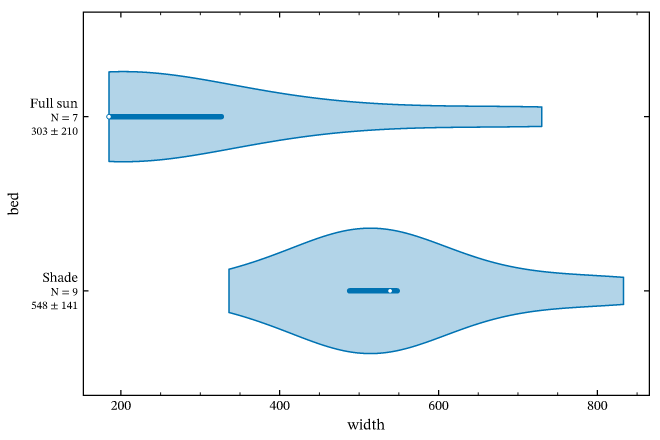<br><code>violin … horizontal summary</code></td>
  </tr>
  <tr>
    <td align="center" width="33%">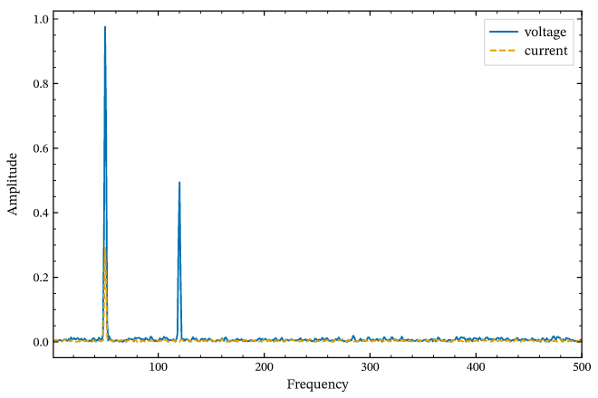<br><code>fft signal.csv x=t y=voltage,current</code></td>
    <td align="center" width="33%">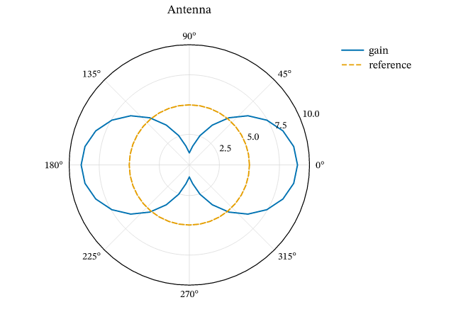<br><code>polar pattern.csv x=angle y=gain,reference</code></td>
    <td align="center" width="33%">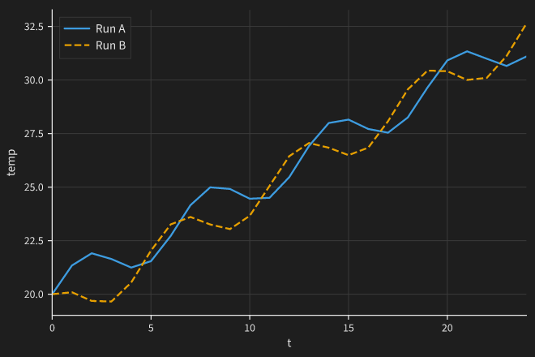<br><code>line … + … --theme=dark</code></td>
  </tr>
</table>

**Plot types:** `line`, `scatter`, `bar`, `hist`, `step`, `area`, `box`, `violin`,
`strip`, `kde`, `heatmap`, `contour`, `polar`, `fft`, and `resid` and `qq` for checking a
fit.

## Install

Apple silicon Mac, macOS 12 or later.

```sh
brew trust --cask praddy-31/tap/easyplots     # Homebrew 7 asks you to trust casks from other taps once
brew install --cask praddy-31/tap/easyplots
```

Or download the `.dmg` from the [latest release](https://github.com/praddy-31/EasyPlots/releases/latest)
and drag EasyPlots to Applications.

EasyPlots is ad-hoc signed, not notarised by Apple (that needs a paid developer account).
The first time you open it, macOS may refuse: allow it in **System Settings → Privacy &
Security → Open Anyway**, or remove the download quarantine yourself:

```sh
xattr -dr com.apple.quarantine /Applications/EasyPlots.app
```

The terminal command comes with the Homebrew cask; with the `.dmg`, choose **Install
Terminal Command…** in the menu-bar icon's menu. Settings → **Try it** has short lessons
on built-in sample data, each opening in the launcher with one click.

## How a command is built

A command is a small tree, much like matplotlib's figure → axes → artists:

```text
line a.csv x=t y=temp,pressure  +  b.csv x=t y=temp axis=right  ;  hist a.csv x=temp   --size=acs
└── layer ────────────────────┘    └── layer ──────────────────┘    └── panel 2 ─────┘   └ figure ┘
└── panel 1 (an overlay: + joins layers) ─────────────────────────┘
```

- A **figure** holds panels, separated by `;`. Options for the whole figure start with
  `--` (`--size=`, `--layout=2x2`, `--theme=dark`, `--legend=top`).
- A **panel** is one plot with its axes: `title=`, `xlim=`, `logy`, `legend=`, marks such
  as `hline=` or `note=`, and readings such as `peaks`.
- A **layer** is a plot type and a file; `+` adds another (a second file, or the same file
  with other options). Data options live here: `x=`, `y=`, `where=`, `err=`, `fit=`,
  `stat=`, `axis=right`.
- A **series** is one line, set of points or bars: one per y column, with its own
  `color=`, `marker=`, `dash=` and `label=` (lists give one each: `color=red,blue`).

Each option is written once, at the level it belongs to. The whole language is in
[`docs/SPEC.md`](docs/SPEC.md), and the map of which option belongs where is in
[`docs/COMMAND_MAP.md`](docs/COMMAND_MAP.md) (and drawn in Settings → Help).

## A quick tour

Press the hotkey, then either pick a file and follow the steps, or type a command:

```text
line run_a.csv x=t y=temp                                  # one line
scatter samples.csv x=dose y=response err=sd fit=linear    # points, error bars, a fitted line
line run_*.csv x=t y=temp stat=mean err=iqr                # the mean of every run_… file
box samples.csv x=site y=response summary                  # boxes with N and mean ± sd
line heating.csv x=T y=storage,loss axis=left,right peaks onset
line a.csv x=t y=temp ; hist a.csv x=temp --layout=1x2 --size=acs
```

| Key | In the launcher |
|---|---|
| ↵ | show the preview; ↵ again saves it (PNG unless you set another format) |
| ⌘1 ⌘2 ⌘3 | save as PNG, PDF or SVG |
| ⌘⇧S | save, choosing where |
| ⌘C / ⌘⇧C | copy the picture / copy the numbers drawn, to paste into a spreadsheet |
| ⇥ | accept a suggestion, or apply the advisor's fix |
| ⌘E | switch between the step-by-step picker and the command |
| ⌘D / ⌘⇧D | keep the look as a style / keep the command as a preset |

Plots go to `~/Plots` unless you choose another folder in Settings, named after the file,
the plot type and the time (`run_a_line_2026-11-15-140223.png`), or as you set.

**From the terminal**, the same language:

```sh
easyplots line data.csv x=time y=temp,pressure title="Run 3"
easyplots scatter run_a.csv x=t y=temp + run_b.csv x=t y=temp --out=compare.pdf
easyplots --columns data.csv                 # the columns and what kind each is
easyplots --each "runs/*.csv" line x=t y=temp  # one plot per file
```

**Settings** (menu-bar icon → Settings…) edits `~/.config/easyplots/config.toml`, which
you can also edit by hand: the comments in it are kept, and changes apply at once. It
covers the hotkey, the data folder, where and how plots are saved, the plot's look
(theme, font, size), the launcher's look, presets and styles, the Try it lessons and
the Help. The launcher's colours follow [Palette](https://github.com/praddy-31/Palette)
themes when Palette is installed, or one of the built-in themes.

## Build from source

Needs Rust (1.95 or later), Node 22 and the Xcode command line tools.

```sh
npm --prefix app ci
npm --prefix app run tauri build     # EasyPlots.app and the .dmg in target/release/bundle/
cargo run -p easyplots-cli -- line tests/fixtures/simple.csv x=time y=temp   # the terminal command
```

Checks:

```sh
cargo fmt --all --check
cargo clippy --workspace --all-targets -- -D warnings
cargo test --workspace                 # the engine, including every gallery plot as a stored SVG
npm --prefix app run check && npm --prefix app run build && npm --prefix app run test:ui
```

**How it's put together:** a Rust engine (`crates/core`) that parses the command, reads
the files and writes every figure as SVG itself; `resvg` turns that SVG into PNG and
`svg2pdf` into PDF, with only the bundled fonts, so all three formats match. The engine
knows nothing about windows, so it's tested on its own (on Linux too). The app
(`app/src-tauri`) is a Tauri v2 shell around it with two small windows in plain
TypeScript, and `crates/cli` is the terminal command. A 50,000-point line plot is saved
as PNG in about 0.1 s. Details in [`docs/ARCHITECTURE.md`](docs/ARCHITECTURE.md).

| Folder | What's in it |
|---|---|
| `crates/core` | the engine: command language, file reading, plotting, fits, SVG/PNG/PDF |
| `crates/cli` | the `easyplots` terminal command |
| `app/src-tauri` | the macOS app: menu-bar icon, hotkey, windows, Settings |
| `app/src` | the launcher and Settings windows (TypeScript, HTML, CSS) |
| `tests/fixtures` | small made-up data files used by the tests and the gallery |
| `docs` | the guides below, the gallery and the README's media |

## Docs

| File | What it is |
|---|---|
| [`docs/FEATURES.md`](docs/FEATURES.md) | Every feature on one page, grouped by task, with an example each |
| [`docs/SPEC.md`](docs/SPEC.md) | The command language, `config.toml` and output file naming in full |
| [`docs/COMMAND_MAP.md`](docs/COMMAND_MAP.md) | The command's structure (figure → panel → layer → series) |
| [`docs/ARCHITECTURE.md`](docs/ARCHITECTURE.md) | How the app is put together, with a glossary |
| [`docs/gallery/`](docs/gallery/) | Example plots, drawn by the tests from the files in `tests/fixtures/` |

Bug reports and ideas are welcome as [issues](https://github.com/praddy-31/EasyPlots/issues):
a file that doesn't load, a plot that looks wrong, or a plot type you miss.

## Credits

EasyPlots stands on a lot of good open-source work. Thank you to everyone behind these.

**The app**

- [Tauri](https://tauri.app): the app shell, its windows and the menu-bar icon, using the
  web view macOS already has, plus its plugins for the global hotkey, the clipboard,
  dialogs, notifications and starting at login.
- [tauri-nspanel](https://github.com/ahkohd/tauri-nspanel): turns the launcher into a
  floating panel that takes the keyboard without pulling you out of the app you were in.
- [fuzzel](https://codeberg.org/dnkl/fuzzel): the launcher's look and feel were modelled
  on it.

**Drawing and saving plots**

- [resvg](https://github.com/linebender/resvg): turns the SVG that EasyPlots writes into
  the PNG.
- [svg2pdf](https://github.com/typst/svg2pdf) and
  [pdf-writer](https://github.com/typst/pdf-writer) from the Typst project: the PDF, with
  the fonts embedded.
- [ttf-parser](https://github.com/harfbuzz/ttf-parser): reads the bundled fonts, so labels
  can be measured before they're drawn.

**Reading your data**

- [csv](https://github.com/BurntSushi/rust-csv): CSV and TSV files.
- [calamine](https://github.com/tafia/calamine): Excel and LibreOffice workbooks.
- [serde](https://serde.rs) and [serde_json](https://github.com/serde-rs/json): JSON files.
- [chrono](https://github.com/chronotope/chrono): dates and times.
- [nucleo](https://github.com/helix-editor/nucleo), the fuzzy matcher from the Helix
  editor: finding files and options as you type.

**Settings**

- [toml_edit](https://github.com/toml-rs/toml): the Settings window changes one value in
  `config.toml` and keeps your comments and layout.
- [notify](https://github.com/notify-rs/notify): notices when you edit `config.toml` by
  hand, so changes apply at once.

**Fonts** (each under its own licence, in `assets/fonts/` and `app/src/fonts/`)

- [JetBrains Mono](https://github.com/JetBrains/JetBrainsMono) by JetBrains: the
  launcher's lettering and the command map in Help.
- [Nerd Fonts](https://github.com/ryanoasis/nerd-fonts) symbols: the launcher's icons.
- [STIX Two](https://github.com/stipub/stixfonts): the default plot font, and its maths
  cut for symbols in labels.
- [Latin Modern](https://www.gust.org.pl/projects/e-foundry/latin-modern) from GUST: for
  plots that should match a LaTeX document.
- [Source Sans 3](https://github.com/adobe-fonts/source-sans) by Adobe: a clean sans-serif
  for slides.

**Colours**

- The [Okabe–Ito palette](https://jfly.uni-koeln.de/color/): the default plot colours,
  readable with every common kind of colour blindness.
- [Palette](https://github.com/praddy-31/Palette): the launcher and Settings follow its
  themes when it's installed.

**Building and testing**

[Vite](https://vite.dev), [TypeScript](https://www.typescriptlang.org) and
[Playwright](https://playwright.dev) (the windows are tested in Chromium and WebKit).

## Licence

[MIT](LICENSE)
