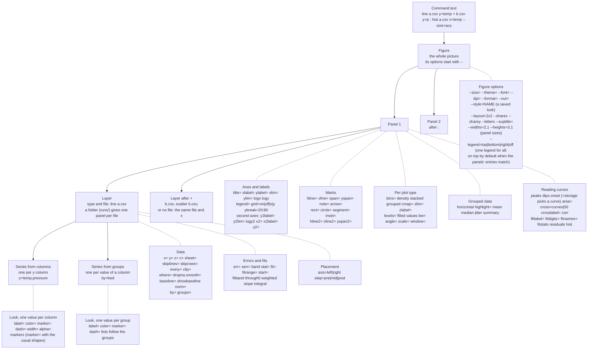

# How a command is built: the map

Every EasyPlots command is a small tree. A **figure** holds one or more **panels**
(separated by `;`); a panel holds one or more **layers** (separated by `+`, one per
`TYPE FILE`); a layer draws one **series** per y column. Each option belongs to exactly
one of these levels. This is the same tree as matplotlib's figure → axes → artists.

Map 1 is the command as it is (`docs/command-map.svg` is the same map as a picture:
redraw it with `docs/make_command_map.sh` when Map 1 changes; the Help tab in Settings
draws its own). An option is written once per level, wherever it stands; only marks
(`hline=`, `note=`…) repeat.
Map 2 is what is still planned (dashed boxes). Zed, GitHub and VS Code draw these blocks
as diagrams.

## Map 1: today

**Which way to make several series:**

| You have | Write | Example |
|---|---|---|
| curves side by side as columns of one file | a list of y columns | `line f.csv x=dose y=growth,yield` |
| the same, each with its own options | `+` without a file | `line f.csv x=dose y=growth + y=yield axis=right` |
| other files or other plot types | `+` with a file | `line a.csv y=t + scatter b.csv y=t` |
| groups as rows, named in one column | `by=` | `scatter f.csv x=width y=yield by=bed` |

## Name clashes found while drawing the map

How each pair of look-alike words was settled.

| Words | Problem | Settled as |
|---|---|---|
| `style=dashed` vs `--style=thesis` | same word for a line's dash and a saved look | `dash=` for lines; `style=` still accepted |
| `markers` vs `marker=o` | `markers` is only a short form of "default markers" | keep both; written together they are refused |
| `step` type vs `step=` | fine in practice (the option only applies to the type) | leave |
| `smooth=5` vs `smooth(col,9)`, `norm(col)` vs `norm=max` | two spellings of one idea | fine: the option is "all columns", the function "this one" (`norm(col)` is 0–1, like `norm=range`) |
| `residuals` (strip) vs `resid` (plot type) | two ways to show residuals | `residuals` kept as the quick strip under a plot; `resid`/`qq` are plot types that combine with `;` and `+` |
| `grid=` on a panel vs `--grid=2x2` | one is lines, the other the panel layout | `--grid=` → `--layout=`; `--grid=` is an unknown option |
| `cross` vs `cross=50` | two features (curves crossing each other, a curve crossing a level) under one word | `cross=curves` and `cross=50`; bare `cross` refused with that message |
| `stats` vs `stat=mean` | look alike, unrelated (numbers written vs one value per group) | `stats` → `summary` |
| `legend=` vs `--legend=` | both place a legend; together the panel's was silently lost | refused together |
| `skip=` vs `skiprows=` | looked alike: lines above the header vs data rows below it | `skip=` renamed `skiplines=` |
| `errorbar` vs `scatter … err=` | two names for the same picture | `errorbar` removed |
