# EasyPlots: every feature in one place

A short guide to everything EasyPlots can do, grouped by what you want to do. Each line
has an example you can type in command mode (or in Terminal after `easyplots`). The full
rules (every edge case) are in `SPEC.md`; this file is the quick reference, and is also
the **Help** tab in Settings (with a search box).

**How a command is built:** `TYPE FILE options`, e.g. `line data.csv x=time y=temp`.

- `+` adds another file or layer to the same plot: `line a.csv y=temp + b.csv y=temp`;
  without a file it uses the same file and x again: `line a.csv x=t y=temp + y=pressure axis=right`
- Options belong to the layer they follow: in `line a.csv y=growth err=sd1 + y=yield err=sd2`, each
  curve gets its own error column
- `;` starts a new panel: `line a.csv y=temp ; hist a.csv x=temp`
- `--options` apply to the whole figure and can go anywhere: `--size=acs --theme=dark`
- Names with spaces or symbols go in quotes: `y="Temp (°C)"` (suggestions add them; if
  you forget, the error offers the quoted version: press `⇥`)
- A long command folds onto up to three lines in the launcher, then scrolls inside

**Several columns or `+`?** `y=growth,yield` and `a.csv y=growth + y=yield` draw the same plot. Use the
list for one file with the same handling (shortest; picker mode writes it). Use `+` for
other files, other plot types (`line … + scatter …`), or different handling per curve
(`where=`, `smooth=`, `fit=`, `slope`). When the groups are rows of one column (a
`bed` column saying Shade / Part sun / Full sun), use `by=bed`: one series per group.

---

## 1. Opening and using the launcher

| Key | Does |
|---|---|
| `Ctrl+Option+P` | open or close the launcher (change it in Settings → General) |
| `↵` | choose / draw a preview / save (from the preview) |
| `⇥` | accept a suggestion; in the column step, tick several columns; in the preview, apply a hint |
| `⌘E` | switch between picker (step by step) and command (typing) mode |
| `⌘Z` / `⌘⇧Z` | undo / redo typing and picker steps |
| `⌘E`, then `↓` `↵` (empty box) | your recent commands, newest first |
| `⌫` (empty box) | go back one picker step |
| `⌘P` | pin: stays open when you click elsewhere (to drag files onto it); `⌘P` or `Esc` unpins |
| `⌘O` | saved-plots browser: your recent plots as pictures; `↵` puts the command back, `⌘↵` opens the file |
| `Esc` | close and start fresh next time (clicking elsewhere keeps your draft for 10 minutes) |

**In the preview:**

| Key | Does |
|---|---|
| `↵` or `⌘S` | save in your plots folder (format from Settings) |
| `⌘1` `⌘2` `⌘3` | save as PNG / PDF / SVG |
| `⌘⇧S` | Save As… anywhere |
| `⌘C` | copy the picture (a PNG; Settings → Copy format for TIFF) |
| `⌘⇧C` | copy the **numbers** drawn (after `where=`, calculations, `stat=`) as a table, to paste into Numbers or Excel: one row per point (series, x, y), with `err` and `fit` (the fitted value at that x) columns when drawn |
| `⌘R` | draw again, reading the file afresh (after you changed it in another app) |
| `⇥` | apply the plot advisor's hint, when it shows `⇥ apply` |
| `⌘D` | keep the **look** as a style (`--style=NAME`) |
| `⌘⇧D` | keep the **whole command** as a preset |

**Picker mode** asks: file → plot type → only the columns that type needs → style (if you
have any). Each column shows its range, mean and blanks.

**Live preview** (Settings → Launcher): a small drawing while you type or pick.

**The file step:** with an empty box, the files of your latest commands come first, then the
newest; JSON files last. Beside the list, the highlighted file's **first 8 rows**, so similar
files are easy to tell apart (files found by whole-disk search are not opened until picked).

**Plot advisor** (Settings → Launcher, on by default): a dim line under the preview when a plot
has a known pitfall, with `⇥ apply` when an option fixes it (`⌘Z` takes it back):

| Noticed | Hint |
|---|---|
| the legend sits on data | `legend=out` (⇥ adds it) |
| one curve looks flat beside another | `axis=right` (⇥ splits `y=a,b` into `y=a + y=b axis=right`) |
| values span 4 or more decades | `logy` / `logx` (⇥ adds it) |
| bars that don't start at 0 (`ylim=`, `logy`) | drop it, or show points |
| bars taller than `ylim=`'s top | a top above the tallest bar (⇥ sets it, e.g. `ylim=0:20`) |
| a `cross=` level no curve reaches (often after `norm=`) | a level in the middle of the curves (⇥ sets it, e.g. `cross=0.51`) |
| error bars from only 2 values (`stat=` over two files) | read them with care, or `err=none` |
| error bars too short to see (shorter than 1 % of their axis, e.g. `x=width xerr=mass`) | check it's the right column |
| more curves than colours, some alike | split into panels with `;` |

---

## 2. Files

| What | How |
|---|---|
| CSV, TSV, TXT | separator, decimal comma, header, dates and missing values are detected |
| Excel / LibreOffice | `.xlsx .xlsm .xls .ods`; first sheet, or `sheet=Run2` / `sheet=2`; each sheet listed in the picker |
| JSON | rows `[{"t":1,…}]`, columns `{"t":[1,2],…}`, arrays, or wrapped in an object; Settings → General → JSON files: all, only tables, or not settings files like `package.json` |
| Numbers | `1234.5`, and with thousands marks `1,234.5` / `1.234,5` (strict groups of three) |
| Times with a zone | `10:00+02:00`, `…Z`: shown on your Mac's clock (10:00+02:00 is 09:00 in London in winter); times without a zone as written |
| Paste | copy cells with a header (Excel, Numbers, web): "Clipboard" is the first file; it's saved in the pasted-data folder |
| Many files at once | `line run_*.csv x=t y=temp` draws every matching file, labelled by name; `color=red,blue` / `marker=` / `label=` lists go one per file. Typing just `run_*.csv` offers the pattern with each folder that has such files ("every matching file in that folder") |
| A folder → a grid | `line runs/ x=t y=temp`: one panel per data file in the folder, titled by file name (up to 36); with `stat=` the folder's files are averaged in one panel instead |
| Sample data | `demo/categorical.csv`, `demo/peak_onset.csv`, `demo/trial.csv`, `demo/spectrum.csv`, `demo/run_a.csv`, `demo/run_b.csv`, `demo/surface.csv`, `demo/outlier.csv`: built into the app, used by Settings → Try it |
| Overlay files | `line a.csv y=temp + b.csv y=temp` |
| Where files are found | the typed path, Terminal's folder, then the data folder; whole-disk search (Spotlight) is optional |
| Drop on the launcher | `⌘P` pins it open, then drag files from Finder onto it (one: picked; several: overlaid) |
| Junk lines above the header | found by themselves; `skiplines=3` sets it by hand |

**Cleaning messy data** (per file):

| Option | Does |
|---|---|
| `skiplines=3` | ignore 3 junk lines above the header (usually found by themselves) |
| `skiprows=10` | leave out the first 10 data rows |
| `every=5` | keep every 5th row |
| `clip=0:100` | y values outside 0–100 become gaps |
| `dropna` | leave out rows with a blank, so lines don't break |
| `where="temp > 20 and site == 'north'"` | keep only matching rows |

---

## 3. Choosing columns and calculating

| What | Example |
|---|---|
| By name or number | `x=time y=temp` · `x=1 y=3` |
| Several y columns | `y=temp,pressure` |
| Pairs of x and y | `x=t1,t2 y=a,b` (a against t1, b against t2) |
| Calculations | `y=power/area` · `x=t/60` · `y="temp*9/5 + 32"` · `y=log10(counts)` |
| Functions | `ln log10 log2 exp sqrt abs sin cos tan asin acos atan sinh cosh tanh floor ceil round` |
| Along the column | `cumsum(col)` running total · `diff(col)` change · `norm(col)` 0–1 · `smooth(col,9)` moving average |
| Smooth everything | `smooth=5` (a moving average; there is no `rolling=`) |
| Scale each curve | `norm=max` (top at 1) · `norm=first` (first value 1) · `norm=area` (area 1) · `norm=range` (0 to 1); also on `kde` and `fft` |
| Take off a baseline | `baseline=0:5,90:100` (a straight line fitted over those x ranges) · `baseline=poly2,0:5,90:100` (a curve; also `const`, `poly3`) · `baseline=linear` (over the first and last tenth) |
| Check the baseline | add `showbaseline`: the data as it is, the fitted baseline dashed, the ranges shaded |
| Odd names in a calculation | backticks: `` y="`Voltage (V)`*1000" `` |
| Defaults | no x/y: first column is x, all other number columns are y; only y: x is the row number |

---

## 4. Plot types

| Type | Draws | Useful options |
|---|---|---|
| `line` | lines through points | `markers`, `dash=`, `band`, `values` |
| `scatter` | points | `marker=`; `c=mass` colours each point by a number column, with a colour bar (`cmap=`, `zlim=`, `zlabel=`) |
| `bar` | bars | `stacked`, `values` (the number on each bar) |
| `step` | steps | `step=pre\|mid\|post` |
| `area` | filled to zero | `stacked`, `y=low,high between` |
| `hist` | histogram (`x=` the values) | `bins=30`, `density`, `stacked` |
| `kde` | smooth density curve | `bw=` |
| `box` | box plots | `x=group` to group by a text column; `summary` writes N and mean ± sd under each |
| `violin` | box plots shaped by density | as `box`, `bw=` |
| `strip` | every value as a dot, per group | `mean`, `median` (`mean=label`, `median=label`), `jitter`; over a box: `box f x=g y=v + strip f x=g y=v` |
| `heatmap` | coloured table | `values`, `cmap=`, `zlim=`, `zlabel=` |
| `contour` | lines of equal value | `filled`, `levels=10`, `cmap=` |
| `resid` | each point's distance from its fit, around a zero line | needs `fit=`; beside the fit: `scatter f x=a y=b fit=linear ; resid f x=a y=b fit=linear`; on the same plot: `… + resid y=b fit=linear axis=right`; as a histogram: `resid … hist` (with `bins=12`, `density`) |
| `qq` | normal Q–Q plot of a fit's residuals: on the dashed line if they are normal | needs `fit=`; a panel of its own |
| `polar` | angle and radius | `angle=rad` |
| `fft` | frequency spectrum (x = time) | `scale=amplitude\|power\|db`, `window=hann\|none` |

Mixing types: `line a.csv y=temp + scatter b.csv y=temp`.

**Groups in one column** (a row per measurement, a column naming its group):

| Option | Example | Notes |
|---|---|---|
| `by=` | `scatter f.csv x=width y=yield by=bed` | one series per group, each its own colour and marker; `color=`, `marker=`, `label=` lists follow the groups |
| `groups=` | `groups=Cold,Hot` | keep only these groups, in this order |
| `strip` | `strip f.csv x=bed y=mass mean` | dots side by side so none hide; a line at each mean |
| `horizontal` | `bar f.csv x=factor y=share horizontal` | bars, boxes, violins and strips on their side; `xlabel=`, `xlim=` are then the values |
| `highlight=` | `highlight="Bed temperature"` | that bar or group in colour, the rest grey, its name in bold |
| `stat=` + `by=` | `bar f.csv x=bed y=yield stat=mean by=soil` | grouped bars of means with sd error bars |
| `summary` | `box f.csv x=bed y=width summary` | N and mean ± sd under each group's name |

A bar chart of a text column needs one row per name; with repeats, use `stat=mean`,
`strip` or `box` (the error says so).

---

## 5. How each series looks

| Option | Example | Notes |
|---|---|---|
| `color=` | `color=orange,blue` | names, `#rrggbb`, or "Pick a colour…"; one per column |
| `marker=` | `marker=o,s,^,v,d` | also `open-circle`, `open-square`, `open-triangle`, `open-triangle-down`, `open-diamond`, `x`, `+`, `none` |
| `dash=` | `dash=solid,dashed` | `solid dashed dotted dashdot` (`style=` still works) |
| `label=` | `label=A,B` | legend text, one per column; quote one with a comma (`label="Run A, warm"`); maths with `$…$` |
| `width=` | `width=2` | line width in points |
| `alpha=` | `alpha=0.5` | see-through; on boxes, violins and areas `alpha=1` makes the fill solid |
| `markers` | `line … markers` | markers on a line, the usual shapes (a short form of `marker=`; write one or the other) |

**Accessible by default:** several scatter series get different shapes (circle, square,
triangle, diamond, triangle down, then outlined ones); several lines get solid, dashed,
dotted, dash-dot. Colours are the colour-blind-safe Okabe–Ito set.

---

## 6. Axes, legend and labels

| What | Example |
|---|---|
| Labels and title | `title="Run 3" xlabel="Time (s)" ylabel="$T$ (°C)"` · `xlabel=""` removes |
| Maths in any label | `$T_{max}$`, `$\alpha$`, `$x^2$`, `$\pm$`, `\frac{a}{b}` … |
| Limits | `xlim=0:10` · `ylim=:5` |
| Tick step | `xlim=0:100:20` · `ylim=::5` |
| Log axes | `logx` · `logy` · `logy2` (the right axis) |
| Broken y axis | `ybreak=20:460` leaves the empty range out, with slanted strokes at the gap (left axis only; not with `logy`) |
| Second y axis (right) | `+ b.csv y=pressure axis=right` with `y2label=`, `y2lim=`; each axis takes its curve's colour (`axiscolor=off`: black) |
| A y axis per column | `y=storage,loss axis=left,right` (e.g. storage and loss modulus) |
| Right axis in other units | `y2="y*1.8+32" y2label="T (°F)"` |
| Top x axis in other units | `x2="1240/x" x2label="Energy (eV)"` |
| Legend | `legend=best\|tr\|tl\|br\|bl\|out\|off` |
| Grid | `grid=on` / `grid=off` · `grid=y` (horizontal lines only) · `grid=x` |
| Numbers on the plot | `values` on bars, points and heatmap cells · `values=%.1f` decimals · `values=%.0f%` adds text (`41%`, tiny ones as `<1%`) · `values=%.0f+-` adds the error (`41 ± 3`; a median: `41 (36–47)`) |

---

## 7. Marking things on the plot

| What | Example |
|---|---|
| Reference lines | `hline=0` · `vline=12.5,20` · with a label: `hline=20:"limit"` |
| Shaded regions | `span=2:5` (x) · `yspan=20:25` (y) · `span=5:8:"heating"` |
| Text at a point | `note="start"@0.5,20` |
| Text in a corner | `note="n = 6 each"@tr` (`tl`, `tr`, `bl`, `br`; several stack up) |
| Text with an arrow | `arrow="peak"@3.5,25.6` |
| Rectangle | `rect=2:5:20:25` · `rect=2:5:20:25:"zone A"` |
| Ring round a point | `circle=@3.5,25.6` · `circle="peak"@3.5,25.6` |
| Straight line | `segment=0,20:10,30` |
| Zoomed inset | `inset=8:11` · with y: `inset=8:11:17:19` · corner: `inset_at=tl` |

These use the bottom x axis and the left y axis. On the second axes: `hline2=80:"limit"`
and `yspan2=1:2` (right axis), `vline2=600` (top axis, with `x2=`).

---

## 8. Errors and fitted curves

| What | Example |
|---|---|
| Error bars | `err=sd` (one per y column: `err=sd1,sd2`) · `xerr=dx`. `err=` works on `line`, `scatter`, `bar` and `step`; `xerr=` on `line` and `scatter`; other plots refuse them. Points with error bars: `scatter data.csv x=dose y=resp err=sd` |
| Shaded error band | `err=sd band` |
| Fitted curve | `fit=linear\|poly2…poly5\|exp\|log\|power` (equation and R² in the legend, written with short column names: `yield = 85.8 − 1.39 · growth`) |
| The equation's names | `fitnames=labels`: from `xlabel=` and `ylabel=`, units in brackets left out (`Harvest = 98 − 18.4 · Dose`); `fitnames=columns` is the default. `label=` names the legend entry only |
| Where the equation goes | `fitlabel=tr` (a corner) · `fitlabel=@20,50` (a point) · `fitlabel=off` · `fitdigits=4` |
| Correlation | `corr` (Pearson r) · `corr=spearman` (r_s, on ranks): in the emptiest corner and in Terminal |
| Your own formula | `fit="a*exp(-x/b)+c"` (rough guesses if needed: `start=a:5000,b:2`) |
| Fit options | `fitband` (95% band) · `through0` · `weighted` (by `err=`) · `fitrange=2:8` · `residuals` (strip below) |
| Fit numbers | in Terminal, each parameter ± its standard error, R² and N after the path |
| Fit numbers on the plot | `fitstats` (the emptiest corner) · `fitstats=tr`: parameters ± error, R², RMSE (root mean square of the residuals) and N |
| Checking a fit | `resid` and `qq` plot types (section 4); `residuals` still adds a strip under the plot |
| Statistics in Terminal | `easyplots --stats data.csv` (N, mean, sd, median, min, max per column) |

**`stat=` and `summary`: two different things.** `stat=` *changes the drawing*: many
values become one value per group (a mean or median with an error bar). `summary` *only
writes numbers* (N, mean ± sd); the drawing stays as it is.

| `stat=mean` / `stat=median` | Works with | What it draws |
|---|---|---|
| one bar or point per group | `bar`, `scatter`, `line` with `x=` a text column: `bar data.csv x=site y=response stat=mean` | each group's mean (median) with an error bar; `line` joins the groups |
| one bar per file | the same types, no `x=`: `bar sample_*.csv y=modulus stat=mean` | each file's mean |
| the mean of several runs | `line run_*.csv x=t y=temp stat=mean`, `line runs/ x=t y=temp stat=mean`, or `a.csv … stat=mean + b.csv … stat=mean` | one curve: the files averaged at each x (numbers in order, with their true spacing); the y axis names the files (names only, no folders) |
| error bars | `err=sd` (default for a mean) · `err=sem` · `err=ci95` · `err=iqr` (default for a median: quartiles) · `err=none` | |
| refused | `area`, `step`, `box`, `strip`, `violin`, `hist`, `kde` (they show spread themselves); one file with one value per x (nothing to average); files with different y columns | |

| `summary` | Works with | What it writes |
|---|---|---|
| under each group | `box`, `strip`, `violin`; `bar … stat=mean summary` | "N = 20" and "10.3 ± 5.6" of the measurements under each name |
| in the legend | `line`, `scatter`, `step`, `area`, `hist`, `kde` | "26.0 ± 3.6, median 25.5, N = 25" under each series' name |
| refused | `heatmap`, `contour`, `polar` | (no legend or groups to write in) |

---

## 9. Reading numbers off curves

| What | Example |
|---|---|
| Slope instead of y | `line heating.csv x=T y=storage slope` (dE1/dT; noisy data: add `smooth=5`) |
| Running area instead of y | `line dsc.csv x=t y=heatflow integral` |
| Area between two x values | `area=80:130`: shaded, the value in the legend and in Terminal |
| Peaks | `peaks` (the highest) · `peaks=3` (the 3 that stand out most): ringed and labelled with x |
| Dips (low points) | `dips` · `dips=2` |
| Onset of a step or peak | `onset`: baseline and steepest tangent drawn, ringed where they cross |
| Onset, baseline chosen | `onset=25:80` (fit the baseline over x from 25 to 80) |
| Only some curves | `peaks=loss` · `dips=storage,loss` · `onset=storage` · `peaks=loss,3`: by their legend name; without a name, every curve of the panel. Each is written once per panel, anywhere in it |
| Where curves cross | `cross=curves`: every pair of curves on the same axis, ringed and labelled with x |
| Where a curve crosses a level | `cross=50` · `cross=20,80`: a dashed line at each level, each crossing ringed (half height: `norm=max cross=0.5`) |
| `curves` or levels, not both | `cross=curves,50` is refused: one `cross=` per panel, either `curves` or numbers |
| What the crossings say | `crosslabel=xy` → `(4.59, 21.4)` · `crosslabel=y` · `crosslabel=off` (rings only) · without it: the x value |
| The numbers | in Terminal after the path, e.g. `storage: onset at T = 96.7` |

These work on `line`, `scatter`, `step`, `area`, `kde` and `fft` plots with
numbers on x, for every curve in the panel (also on the right axis). A peak must stand out
by at least 5 % of the curve's height, so noise isn't counted (on a noisy curve,
`peaks=3` with only two real peaks can still ring a noise bump as the third); for a peak,
`onset` uses its rising side, with the tangent on the steepest stretch.

---

## 10. Several panels

| What | Example |
|---|---|
| New panel | `line a.csv y=temp ; hist a.csv x=temp` |
| Layout | `--layout=2x2` (`grid=` without `--` is the grid lines) |
| Panel sizes | `--widths=2,1` (relative column widths) · `--heights=3,1` (row heights, e.g. a fit over a short residuals strip) |
| One legend for the figure | `--legend=bottom` (also `right`, `top`): the panels' entries collected once, outside the panels; not together with a panel's `legend=` |
| Legend default | when the panels' legends list the same entries: one legend on top; a single legend goes above its panel (top row). `--legend=off` or `legend=` on a panel keeps them inside |
| Shared axes | `--sharex` · `--sharey` |
| Letters (a), (b)… | `--letters` |
| Title over all | `--suptitle="Results"` |

---

## 11. Size, look and saving

| What | Example |
|---|---|
| Size | `--size=6x4in` (also `cm mm pt`) |
| Journal sizes | `--size=acs` · `aip` (JCP) · `aps` · `rsc` · `nature` · `science` · `elsevier` · `column` · add `-double` for full width; text drops to 8 pt |
| Theme | `--theme=light\|paper\|dark\|palette` (`light` is the default; `paper` is the journal look) |
| Font | `--font="Latin Modern"` · `"STIX Two"` · `"Source Sans"` |
| Format | `--format=pdf` or `--out=name.pdf` |
| Resolution | `--dpi=600` (PNG) |
| File name | `--out=fig1.png` (otherwise automatic: `{file}_{type}_{date}-{time}`) |
| Style (look only) | `--style=thesis` (made with ⌘D) |
| Preset (whole command) | `preset NAME FILE` (made with ⌘⇧D) |
| Edit a saved plot | `again ~/Plots/data_line_….png` |

Nothing is ever overwritten (`-2`, `-3`… is added). Every saved plot remembers its command.

---

## 12. Terminal

After menu-bar icon → **Install Terminal Command…**:

| Command | Does |
|---|---|
| `easyplots line data.csv x=t y=temp` | save a plot (`label="Run A","Run B"` works as in the launcher; one label with a comma: `label='"Run A, warm"'`) |
| `easyplots --columns data.csv` | list the columns with their range and mean |
| `easyplots --stats data.csv` | N, mean, sd, median, min and max of each number column |
| `easyplots again PLOT` | print a saved plot's command; with options, draw it again |
| `easyplots preset` · `preset NAME FILE` | list presets / use one |
| `easyplots --each "runs/*.csv" line x=t y=temp` | one saved plot per matching file, each path printed |
| `easyplots --svg …` · `--time …` | print SVG / show timings |

The plot advisor's hints are printed as `hint: …` (on stderr, so scripts still get only the paths).

---

## 13. Settings

Menu-bar icon → **Settings…**. Everything is also in `~/.config/easyplots/config.toml`.

| Tab | Holds |
|---|---|
| General | hotkey, data folder, whole-disk search, launch at login, which JSON files are listed |
| Saving | plots folder, pasted-data folder, format, file name, dpi, size, what happens after saving (thumbnail, notify, open, reveal in Finder, nothing) |
| Plot look | theme, font, font size, line width, grid, legend |
| Launcher | mode, colours, opacity, blur, font, size, hints, live preview, plot advisor, history |
| Presets & styles | list and delete |
| Try it | short lessons on the sample data, each with its command and picture; **Open in launcher** puts the command in the box and draws it |
| Help | this list and the command map, with a search box: type `fit band` to see only the matching rows |

**Launcher glass:** Opacity goes from 1 (solid) all the way to 0 (fully see-through); below
40 % solid Settings warns that text gets hard to read, but nothing stops you. Blur is a
strength from 0 (off) to 100 (20 is light, like Ghostty's). Palette can set both: in Palette
→ Apps → EasyPlots → Glass pick Solid, Blurred or Clear (or `palette glass easyplots blurred
--strength 30 --blur 40`). Settings → Launcher then shows "Glass set by Palette" and dims its
own sliders; pick **Yours** in Palette to hand them back.
